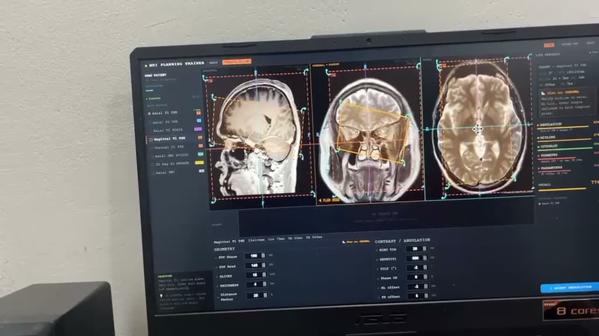
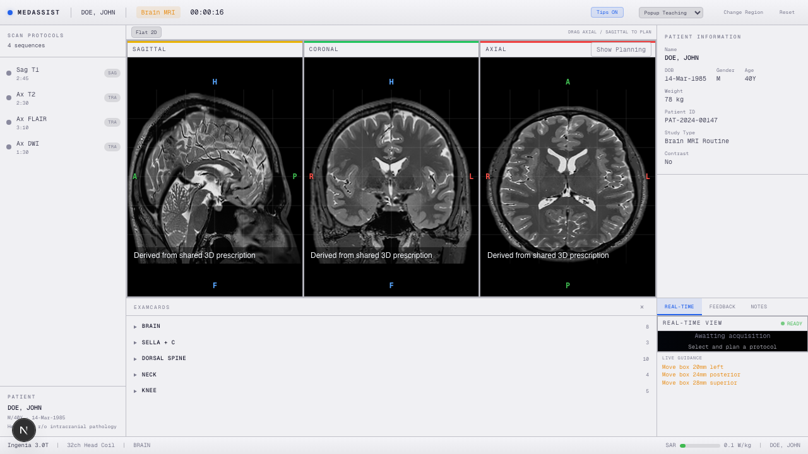
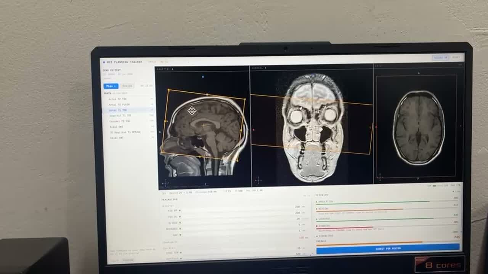
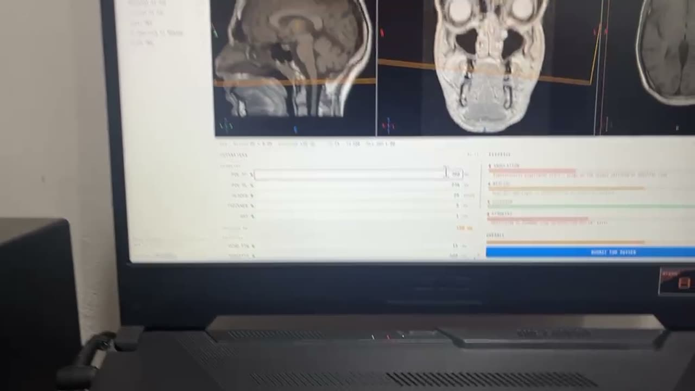
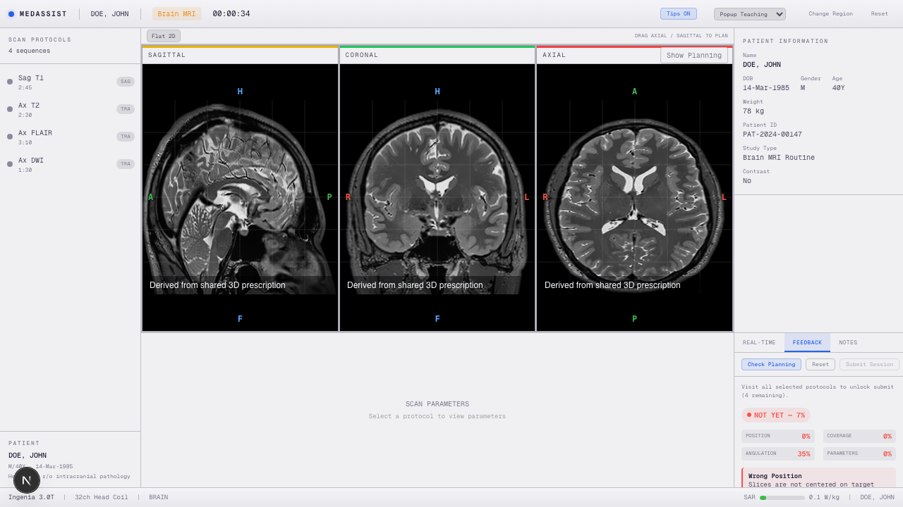
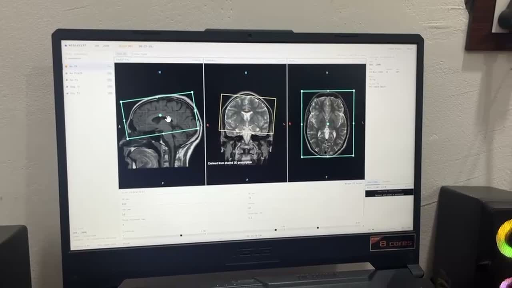
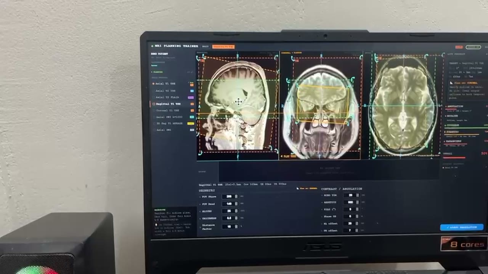
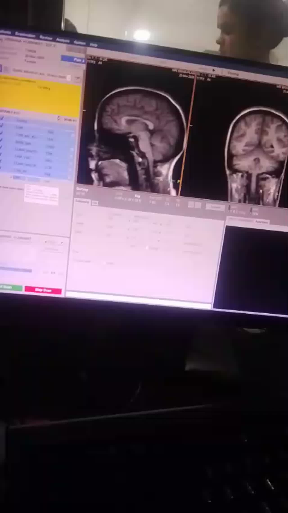

# Competitive Analysis: MedAssist vs Reference MRI Planning Trainer

**Date:** April 2026
**Scope:** Brain planning only
**Evidence:** Extracted frames from 4 reference videos + fresh MedAssist screenshots

---

## Video Sources

| Video | Duration | Content | Key Evidence |
|-------|----------|---------|--------------|
| Video 1 (08.51.26) | 21s | Real Philips MRI console | Clinical planning UI benchmark |
| Video 2 (09.19.03) | 4m 12s | Competitor trainer — planning | Box interaction, parameter panel, protocol context |
| Video 3 (09.19.16) | 1m 51s | Competitor trainer — review/feedback | Feedback bars, coaching text, criteria breakdown |
| Video 4 (09.19.27) | 1m 34s | Competitor trainer — box manipulation | Box handles, derived views, drag interaction |

---

## Summary Verdict

The competitor ("MRI Planning Trainer") is ahead on the **core planning interaction** — box visibility, feedback specificity, and parameter integration. MedAssist is ahead on **educational scaffolding** — guided teaching, quizzes, scan simulation, session reports.

If a client sees both during the planning phase, the competitor wins on first impression. But MedAssist has features the competitor lacks entirely.

**Strategic conclusion:** Close the planning interaction gap while keeping MedAssist's educational advantages.

---

## Evidence: Side-by-Side Comparison

### Planning State

**Competitor (Video 2, frame 01):**


Key observations:
- **Bright orange/cyan prescription boxes** dominate each view
- **Circular rotation handles** at corners — obvious drag affordances
- **Center crosshair** icon visible inside the box
- **Red dashed outer boundary** showing full imaging volume extent
- **"Derived from shared 3D prescription"** label ON the coronal canvas
- **Color distinction**: cyan = editable, orange/yellow = derived
- **Planning priorities** section bottom-left with protocol-specific text
- **Protocol context line**: "Sagittal T1 TSE 11sl×4mm Coverage 75mm TE 61mm TR 500ms"
- **"Plan on: CORONAL"** hint — tells student which view to work in
- GEOMETRY + CONTRAST/ANGULATION parameter split at bottom

**MedAssist (current):**


Key observations:
- Clean tri-planar layout with real MRI data
- Planning box outlines are thin and hard to distinguish from anatomy
- No rotation handles visible — user discovers rotation by hovering corners
- No center crosshair marker
- No volume boundary indicator
- "DERIVED" label is 7px text in header bar, not on canvas
- No persistent protocol context during free planning
- Parameters hidden behind ProtocolBrowser expand

### Feedback State

**Competitor (Video 3, frame 01):**


Key observations:
- Named feedback categories with **progress bars**: ANGULATION, MIDLINE, COVERAGE, SYMMETRY, PARAMETERS
- Color-coded per category (red/orange/green fills)
- **Specific coaching text**: "Significantly misaligned (13deg) — align to the corpus callosum on SAGITTAL view"
- **Per-view directions**: "Shift anteriorly on CORONAL view"
- OVERALL composite bar
- "SUBMIT FOR REVIEW" button

**Competitor (Video 3, frame 02 — close-up of feedback panel):**


Shows the parameter panel alongside feedback bars — both visible simultaneously. Feedback text references specific views and landmarks.

**MedAssist (current):**


Key observations:
- Percentage scores in small text (Position 0%, Coverage 0%, etc.)
- Structured findings with directional hints — but in tiny side panel
- Reads like log output, not coaching
- No progress bars
- No per-view guidance
- Scoring data IS there (buildFindings produces good data) — presentation is the gap

### Box Interaction

**Competitor (Video 4, frame 02):**


Key observations:
- Large cyan box with visible **circular drag handles** at corners
- **Center crosshair** with grab cursor
- Coronal view shows "Derived from shared 3D prescription" label
- Box takes up significant portion of each view — impossible to miss
- Hand cursor visible = dragging interaction

**Competitor (Video 2, frame 03 — Sagittal T1 with rotation handles):**


Shows the box with rotation handle circles at corners, red dashed boundary, and protocol-specific planning priorities text at bottom left.

### Real Console (Video 1)

**Philips MRI Console:**


Shows the actual scanner planning UI — dense parameter list on left (yellow highlight), sagittal + coronal views with orange prescription boxes, crosshairs, Accept/Stop Scan buttons. This is the clinical benchmark that both products are approximating.

---

## What The Competitor Does Better

### 1. Prescription box is dramatically more visible

| Aspect | Competitor | MedAssist |
|--------|-----------|-----------|
| Border thickness | 3-4px bright cyan/orange | ~1px thin cyan |
| Rotation handles | Visible circular affordances at corners | Hidden — discovered by hovering |
| Center marker | Crosshair icon with grab cursor | None |
| Volume boundary | Red dashed outline showing full extent | None |
| Editable vs derived | Color-coded + on-canvas label | 7px text in header |

**Evidence:** Compare v2_01.jpg (competitor) vs 03-planning-state.png (ours). Their box commands immediate attention. Ours requires hunting.

**Why this matters:** The box IS the planning task. If it doesn't dominate the visual hierarchy, the training loop is weaker. This is the #1 product gap.

### 2. Feedback is category-based coaching, not score dumps

| Aspect | Competitor | MedAssist |
|--------|-----------|-----------|
| Categories | ANGULATION, MIDLINE, COVERAGE, SYMMETRY, PARAMETERS | Position, Coverage, Angulation, Parameters |
| Visualization | Color-coded progress bars | Percentage numbers in small text |
| Coaching text | Per-view landmark references | Generic directional hints in findings panel |
| Clinical concepts | Midline + Symmetry as separate criteria | Lumped into "Position" |

**Evidence:** v3_01.jpg shows "align to the corpus callosum on SAGITTAL view" — the student knows exactly what to fix and where. Our feedback says "Slices are not centered on target anatomy" — true but not actionable enough.

### 3. Protocol context is persistent during planning

The competitor shows a context line throughout planning: "Sagittal T1 TSE 11sl x 4mm Coverage 75mm TE 61mm TR 500ms". Plus a PLANNING PRIORITIES section with protocol-specific instructions and a "Plan on: CORONAL" hint.

MedAssist's teaching popups dismiss, leaving no persistent reminder of what the student is trying to achieve.

### 4. Parameters are integrated, not separated

The competitor's GEOMETRY / CONTRAST+ANGULATION panel sits at the bottom of the screen, always visible during planning. MedAssist's parameters are inside the ProtocolBrowser, collapsed behind ExamCard folders.

---

## What MedAssist Does Better

### 1. Guided teaching flow (competitor has nothing like this)

MedAssist's show_target -> info -> parameters -> quiz -> planning flow is a genuine differentiator. The competitor drops students into planning with zero scaffolding. A student who doesn't know what T1 Sagittal is for gets no help.

**Evidence:** Our SequenceInfoPopup shows purpose, planning hints, and checklists. Our PopupTeachingStrategy walks through parameters one-by-one with real-life analogies. The competitor has editable fields but zero teaching.

### 2. Parameter teaching with analogies and quizzes

TR explained as "camera flash intervals", quiz mode where students fill in values from memory. This is real educational value that a clinical console or the competitor cannot offer.

### 3. Simulated scan results

After "Run Scan", MedAssist generates volume-based axial slices showing what the planned volume would produce. The competitor has "Submit for Review" but no simulated image output.

### 4. Session reporting

Per-protocol scores, pass/fail badges, summary statistics, aggregated performance review. The competitor doesn't appear to have this.

### 5. Sequence ordering as teaching step

DnD ordering modal teaches clinical workflow reasoning before planning begins. The competitor has a sequence list but no ordering validation.

---

## Critical Gaps (Product-Level, Not Polish)

### Gap 1: Box interaction is the #1 product blocker

The planning box needs:
- Thicker borders (3-4px)
- Visible rotation handle affordances (circles at corners)
- Center crosshair marker
- Volume boundary outline (dashed)
- Per-view editable/derived labels ON the canvas
- Different colors for editable vs derived views

**Implementation target:** `LocalizerCanvas.tsx` drawing functions (drawFlatOutline, drawProjectedOutline)

### Gap 2: Feedback needs to become per-view coaching

Transform from text findings to:
- Named criteria with progress bars (Angulation, Midline, Coverage, Symmetry, Parameters)
- Per-view directions ("fix this on SAGITTAL view")
- Landmark references ("align to corpus callosum")
- Overall composite bar

**Implementation target:** `FeedbackPanel.tsx` + extend `scoring.ts` buildFindings()

### Gap 3: No persistent protocol context during free planning

Need a fixed context bar showing:
- Sequence name + key params (TR, TE, FOV, Coverage)
- One-line planning instruction
- "Plan on: SAGITTAL + AXIAL" hint

**Implementation target:** New component in `WorkstationLayout.tsx` above canvas panels

### Gap 4: Parameters disconnected from planning surface

Move to always-visible bottom panel:
- GEOMETRY (FOV, Slices, Thickness, Gap) on left
- CONTRAST/ANGULATION (TR, TE, Flip, Phase) on right
- Computed Coverage in mm

**Implementation target:** Rework `DynamicParameterPanel.tsx` placement in layout

### Gap 5: No MIDLINE or SYMMETRY feedback

These are the most common student mistakes in brain planning. The competitor scores them separately. We lump them into "Position".

**Implementation target:** Extend `scoring.ts` with midline alignment and L-R symmetry metrics

---

## False Alarms / Things We Should NOT Over-Prioritize

1. **Dark vs light theme** — Both apps use dark themes. Color scheme changes are pure cosmetic.

2. **Visual density for its own sake** — Adding chrome that doesn't help the student understand planning is wasted effort.

3. **Exact UI clone** — Their layout is good but MedAssist's teaching flow is a real advantage. Don't sacrifice it for visual parity.

4. **More body regions** — Brain isn't nailed yet. Don't spread thin.

5. **3D box rendering** — The cube3d wireframe adds nothing for beginners. Flat 2D outlines are clinically correct.

---

## Top 5 Recommendations

### 1. Rebuild prescription box visuals (HIGHEST LEVERAGE)

The box is the product. If it doesn't command attention, nothing else matters.

- 3-4px borders with glow
- Circular rotation handles at corners
- Center crosshair marker
- Dashed volume boundary outline
- Color-coded editable (cyan) vs derived (orange)
- On-canvas "EDITABLE" / "DERIVED" labels

### 2. Transform feedback into visual coaching (HIGH LEVERAGE)

The scoring data already exists. This is a presentation upgrade.

- Named criteria bars: Angulation, Midline, Coverage, Symmetry, Parameters
- Color-coded progress fills (red/orange/green)
- Per-view coaching: "align to corpus callosum on SAGITTAL"
- Overall composite bar
- Replace tiny text findings with structured coaching cards

### 3. Add persistent protocol context during planning (MEDIUM)

One-line always-visible bar:
```
T1 Sagittal | 22sl x 4mm | FOV 230mm | Plan on: SAGITTAL + AXIAL
"Align slices along the inter-hemispheric fissure"
```

### 4. Move parameters to always-visible bottom panel (MEDIUM)

GEOMETRY | CONTRAST layout, visible during planning. Not hidden behind ExamCard browser.

### 5. Add MIDLINE and SYMMETRY scoring criteria (MEDIUM)

Extend scoring to evaluate:
- Midline alignment (box centered on interhemispheric fissure)
- Left-right symmetry (equal coverage bilaterally)

---

## Suggested Build Order

| Order | Work | Impact | Effort |
|-------|------|--------|--------|
| 1 | Box visuals overhaul | Closes biggest competitive gap | Medium — canvas drawing code |
| 2 | Feedback coaching panel | Makes scoring data usable | Medium — new panel component |
| 3 | Protocol context bar | Persistent planning guidance | Small — new info strip |
| 4 | Parameter panel relocation | Planning-parameter connection | Medium — layout restructure |
| 5 | Midline + symmetry scoring | Deeper clinical teaching | Medium — scoring extension |

Items 1-2 close the biggest competitive gap.
Items 3-4 make the product feel professional.
Item 5 deepens clinical teaching value.

This order follows AGENTS.md: **core correctness before UI/UX**.

---

## Appendix: Evidence File Index

### Competitor Frames (New Videos)
- `video-new-1-console/v1_01-04.jpg` — Real Philips MRI console
- `video-new-2-trainer/v2_01-06.jpg` — Competitor planning state
- `video-new-3-trainer-review/v3_01-04.jpg` — Competitor feedback/review
- `video-new-4-trainer-boxes/v4_01-04.jpg` — Competitor box interaction

### Competitor Frames (Original Videos)
- `video-1-console/` — Console planning frames
- `video-2-trainer-planning/` — Trainer planning frames
- `video-3-trainer-review/` — Trainer review frames
- `video-4-trainer-boxes/` — Trainer box frames

### MedAssist Current Screenshots
- `current-app/01-landing.png` — Landing page
- `current-app/02-ordering.png` — Sequence ordering modal
- `current-app/03-planning-state.png` — Planning with MRI views
- `current-app/04-feedback-state.png` — Feedback after Check Planning
