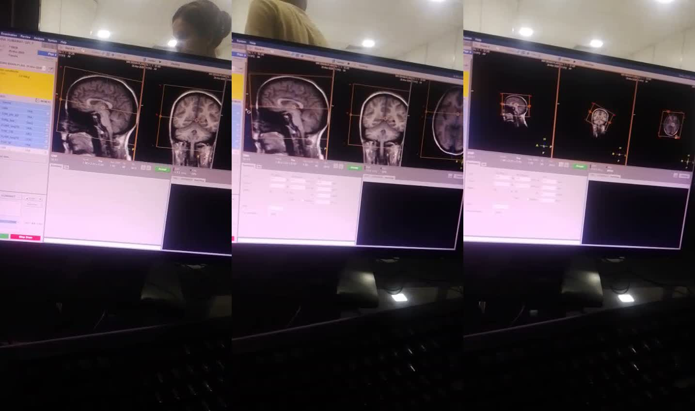
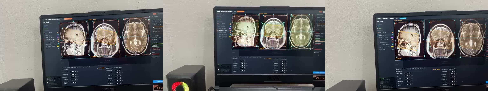
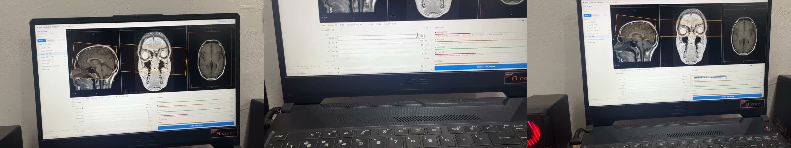
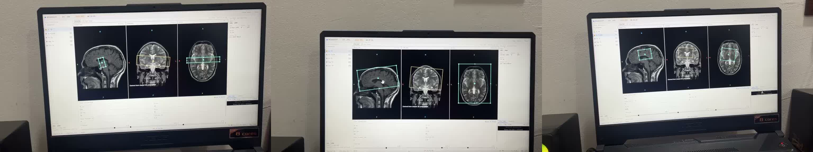
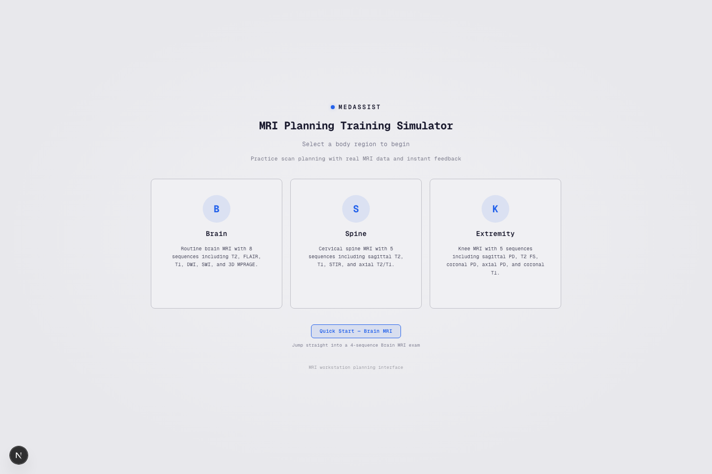
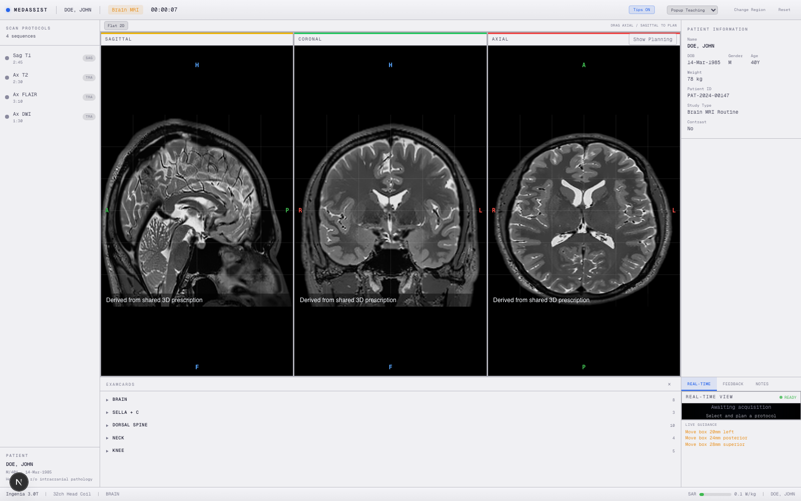
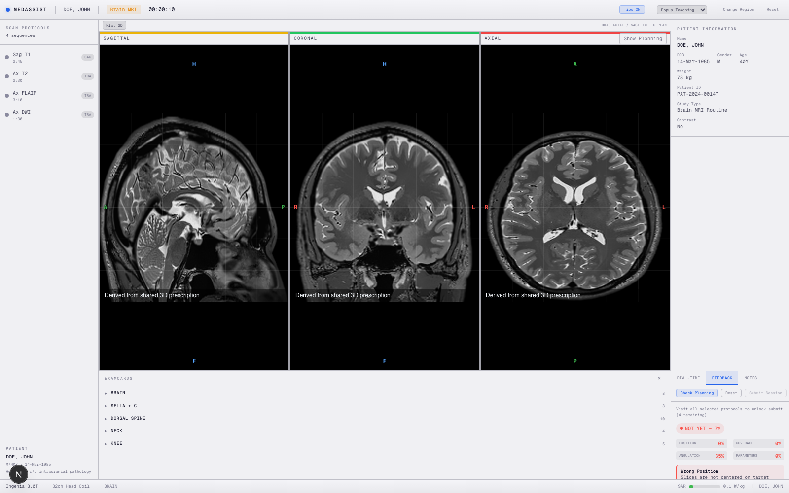

# Reference Video Evidence Pack

## Purpose

This folder stores the image evidence used for the comparison between the reference videos and the current MedAssist web app.

Use it together with:

- [../REFERENCE_VIDEO_COMPARISON.md](../REFERENCE_VIDEO_COMPARISON.md)

## Folder Structure

- `video-1-console/`
  Frames from the workstation-style console video.
- `video-2-trainer-planning/`
  Frames from the planning-focused trainer video.
- `video-3-trainer-review/`
  Frames from the review and scoring video.
- `video-4-trainer-boxes/`
  Frames from the prescription-box placement video.
- `current-app/`
  Screenshots captured from the current MedAssist app for side-by-side context.

## Video 1: Workstation-Style Console

What it shows:

- dense clinical UI
- direct planning on tri-planar MRI views
- visible planning boxes and crosshair relationships

Why it matters:

- this is the strongest example of **clinical realism**
- it makes the planning task feel serious and grounded in scanner workflow

## Video 2: Trainer Planning Layout

What it shows:

- a cleaner trainer-style planning screen
- multi-planar brain views
- visible target/planning overlays
- a more educational layout than a raw console

Why it matters:

- this is the strongest example of **structured planning UI**
- it connects planning visuals with training flow better than a pure console

## Video 3: Trainer Review / Feedback

What it shows:

- the same planning context paired with review content
- visible validation or feedback panels
- a more explicit learning loop after the planning step

Why it matters:

- this is the strongest reference for **feedback visibility**
- it helps explain why our app needs feedback to feel more like coaching, not just a score dump

## Video 4: Prescription Box Placement

What it shows:

- strong emphasis on the prescription box itself
- clear box orientation and placement across sagittal/coronal/axial views
- planning geometry as the central focus

Why it matters:

- this is the clearest reference for the gap in our current product
- it shows how visually dominant the planning geometry should be

## Current MedAssist App

### Home Screen

What it shows:

- clean entry point
- guided onboarding into region selection
- strong beginner-friendly flow

### Planning State

What it shows:

- good tri-planar structure
- clear protocol list and patient panel
- a training-oriented workstation shell

What still feels weak:

- the prescription state is not visually dominant enough
- the core planning interaction needs stronger emphasis

### Feedback State

What it shows:

- explicit check action
- pass/fail and component scoring
- a visible feedback panel

What still feels weak:

- the feedback is still too compressed
- the panel reads as a side widget instead of the main teaching moment

## How To Read The Comparison

The comparison is not saying the references are simply “better”.

The references are better at:

- clinical density
- prescription-box visibility
- workstation credibility

MedAssist is better at:

- guided learning flow
- approachability
- training structure
- long-term extensibility as a teaching product

The product goal should be to combine:

- the **credibility and geometry clarity** of the references
- with the **teaching flow and feedback structure** already present in MedAssist
